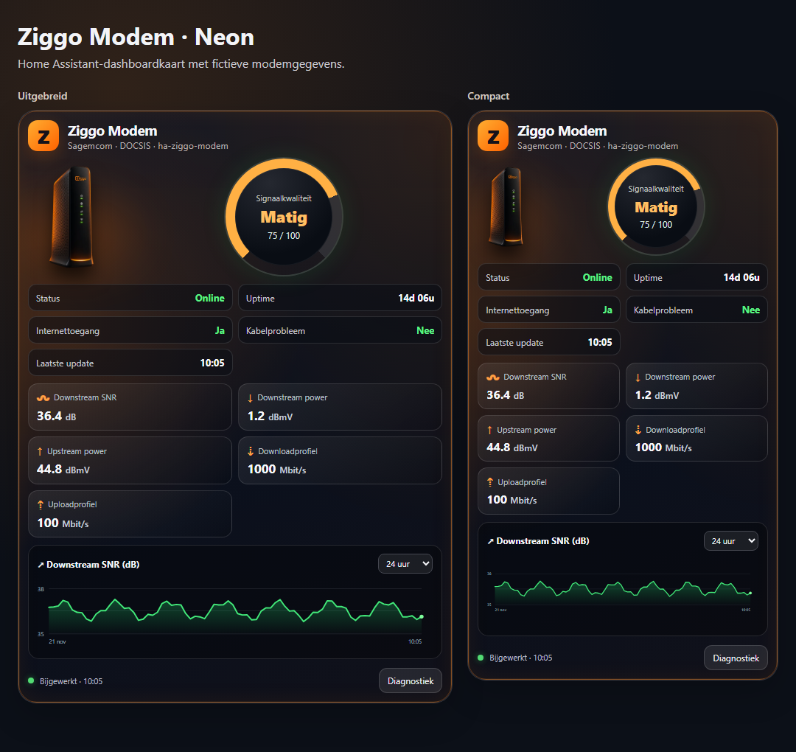

# Ziggo Modem

[](https://github.com/dkwolf1/ha-ziggo-modem/releases)
[](https://github.com/dkwolf1/ha-ziggo-modem/commits/main)
[](LICENSE)

[](https://github.com/pre-commit/pre-commit)
[](https://github.com/astral-sh/ruff)
[](https://hacs.xyz)

[]()
[](https://www.home-assistant.io/)

---

## English

Local Home Assistant integration for Ziggo cable modems (Sagemcom).

[Wiki: readings, alerts and troubleshooting](wiki/English.md)

This integration gives insight into your DOCSIS connection, including signal
quality, stability, error counters and network status. It works locally and
does not use SmartWifi Web or any external Ziggo website.

### Optional Dashboard Card

**Ziggo Modem · Neon** brings signal quality, connectivity, and DOCSIS readings
together on your dashboard. Starting with Ziggo Modem **v1.7.0**, the integration
includes the card and registers its JavaScript module automatically.

1. Install or update Ziggo Modem, then restart Home Assistant and refresh your
   browser.
2. Edit your dashboard, select **Add card**, and choose **Ziggo Modem · Neon**.
   The card editor lets you select a modem, change the layout and choose tiles.
3. If you installed the standalone card through Marketplace, uninstall the
   standalone package there. If its old `ziggo-modem-card.js` entry is still
   present, remove it from **Settings → Dashboards → Resources** or from your
   YAML resources. Refresh the browser. Keep your existing dashboard card and
   its settings.

To add the card using YAML:

```yaml
type: custom:ziggo-modem-card
```

Choose **Full width** in the card editor, or set `layout: full` in YAML, for a
wider tile layout and a larger SNR chart. In a Sections dashboard, the card
fills its section. Increase the section width to span several dashboard columns.
If the card has a manual size, enable **Use recommended size** in the
card's **Layout** tab to apply the new sizing.

The header shows the modem-reported DOCSIS version when available. The optional
24-hour and 7-day downstream SNR graph uses the Home Assistant Recorder history.



### Features

- Modem status and uptime
- Device info with model, firmware, hardware revision, serial number and MAC
  address when available from the modem API
- Downloadable, privacy-redacted Home Assistant diagnostics
- Configurable DOCSIS signal thresholds
- Persistent connection interruption and failed update history
- Automatic reauthentication when modem credentials change
- Per-sensor availability when an individual API endpoint fails
- Downstream signal analysis (power, SNR, errors)
- Upstream monitoring (power, timeouts)
- SC-QAM and OFDM error analysis
- Download and upload profile detection
- Last successful update timestamp
- Per-endpoint API status diagnostics
- Per-endpoint error codes in API Status and downloaded diagnostics
- Optional verbose diagnostics with channel details

### Installation

Requires Home Assistant Core 2026.7.0 or newer.

#### Marketplace (Home Assistant 2026.11 and newer)

1. Go to **Settings > Marketplace**, or open [Ziggo Modem directly](https://my.home-assistant.io/redirect/marketplace_repository/?owner=dkwolf1&repository=ha-ziggo-modem&category=integration).
2. If the Marketplace does not know this repository yet, add it as a custom
   repository when prompted.
3. Install **Ziggo Modem** and restart Home Assistant if requested.

Existing HACS installations are transferred to the Marketplace automatically
when upgrading Home Assistant; do not reinstall the integration.

#### HACS (Home Assistant 2026.10 and older)

1. Go to **HACS > Integrations**.
2. Click **three dots > Custom repositories**.
3. Add this repository.
4. Select category **Integration**.
5. Install **Ziggo Modem**.
6. Restart Home Assistant.

#### Manual

1. Copy `custom_components/ziggo_modem` to your Home Assistant configuration
   directory.
2. Restart Home Assistant.

### Removal

1. Go to **Settings > Devices & services > Ziggo Modem** and delete the
   integration entry.
2. If installed through the Marketplace, uninstall **Ziggo Modem** from
   **Settings > Marketplace > Installed**. On older versions, uninstall it from
   **HACS > Integrations** instead.
3. For a manual installation, remove `custom_components/ziggo_modem` from your
   Home Assistant configuration directory. Restart Home Assistant if requested.

Removing the integration does not change modem settings. Previously saved
problem-history data may remain in Home Assistant's `.storage` directory.

### Configuration

The integration is configured through the Home Assistant UI:

**Settings > Devices & services > Add integration > Ziggo Modem**

Enter:

- IP address (default: `192.168.100.1`)
- Username (optional; leave empty for password-only modems)
- Password
- Language: `Nederlands` or `English`

The integration requires direct local access to the modem interface/API. The
local modem IP must be reachable from Home Assistant. SmartWifi Web/cloud login
is not used.

**Local HTTPS:** The integration uses HTTPS but does not verify the modem's
certificate during setup or normal operation, to support modems with
self-signed certificates. The connection is encrypted, but Home Assistant
cannot verify that it is talking to your modem. Use the integration only on
a trusted local network and do not expose the modem's management interface
to the internet.

### Options

Open **Settings > Devices & services > Ziggo Modem > Configure** to change:

- Polling interval (default: `60 seconds`; range: `5-3600 seconds`)
- Minimum downstream power (default: `-10 dBmV`)
- Maximum downstream power (default: `10 dBmV`)
- Minimum downstream SNR (default: `34 dB`)
- Maximum upstream power (default: `52 dBmV`)
- Verbose diagnostics (off by default)
- Language (`Nederlands` or `English`)

These thresholds affect signal quality, issue classification and the cable
issue sensor. The defaults preserve the original integration behavior. The
cable issue sensor keeps an additional safety margin to avoid triggering on
minor fluctuations.

If the modem password changes, Home Assistant displays a reauthentication
prompt. Enter the current modem credentials there; removing and adding the
integration again is not required.

If the modem IP address changes, use **Reconfigure** on the integration to
enter the new address. **Configure** remains for polling, signal thresholds,
diagnostics and language; neither action requires removing the integration.

### Sensors

General:

- Modem status
- Uptime
- Signal quality
- Signal quality explanation
- Signal quality advice
- Line stability
- API status
- Last successful update
- Connection interruptions
- Failed updates
- Last modem restart
- Issue classification

Downstream:

- Downstream power (dBmV)
- Downstream SNR (dB)
- Channel count
- Locked channels
- SC-QAM / OFDM errors

Upstream:

- Upstream power (dBmV)
- Channel count
- T3 timeouts

Profile:

- Download profile (Mbit/s)
- Upload profile (Mbit/s)

Binary sensors:

- Cable issue
- Internet outage
- Upstream timeouts present
- Internet access

The Cable issue sensor includes diagnostic attributes with all active reason
codes, translated explanations and the measurements that triggered it. This
makes it possible to distinguish an unlocked channel, low SNR, abnormal power,
timeouts or a high OFDM error rate without downloading diagnostics first.

Switches and buttons:

- Pause integration
- Verbose diagnostics
- Release session
- Restart modem

### Diagnostics

For troubleshooting or a GitHub issue, download a diagnostic file from:

**Settings > Devices & services > Ziggo Modem > three-dot menu > Download diagnostics**

The download is also available from the modem device page. It contains the
integration settings, coordinator status, endpoint results and the latest modem
API data. Passwords, usernames, tokens, local IP addresses, serial numbers, MAC
addresses and network identifiers are automatically redacted. Review the file
before sharing it publicly.

If a modem API endpoint briefly fails, dependent entities keep their last reading
for up to 10 minutes. API Status reports temporary errors and a warning is logged
when an endpoint starts failing. After 10 minutes without a successful reading,
only entities that depend on that endpoint become unavailable. A complete modem
outage follows the same grace period; authentication failures still require
reauthentication. Other modem entities continue updating.

### Problem history

Connection interruptions and completely failed updates are stored persistently,
so the counters survive Home Assistant restarts. An interruption is counted
only when the modem changes from reachable to unreachable. A failed update is
counted when all modem API endpoints fail; an isolated endpoint failure remains
visible in API diagnostics but does not increase this counter. The last modem
restart is estimated from the uptime reported by the modem.

### Notes

- Uses an undocumented Ziggo modem API.
- Works locally only.
- OFDM values may differ per firmware version.
- Primarily tested on Sagemcom Ziggo modems.

---

## Nederlands

Lokale Home Assistant integratie voor Ziggo kabelmodems (Sagemcom).

[Wiki: metingen, meldingen en probleemoplossing](wiki/Nederlands.md)

Deze integratie geeft inzicht in je DOCSIS-verbinding, zoals signaalkwaliteit,
stabiliteit, fouttellers en netwerkstatus. De integratie werkt lokaal en gebruikt
geen SmartWifi Web of externe Ziggo-website.

### Optionele Dashboardkaart

**Ziggo Modem · Neon** brengt signaalkwaliteit, verbindingsstatus en
DOCSIS-metingen samen op je dashboard. Vanaf Ziggo Modem **v1.7.0** levert de
integratie de kaart mee en registreert ze de JavaScript-module automatisch.

1. Installeer of update Ziggo Modem, herstart Home Assistant en vernieuw je browser.
2. Bewerk je dashboard, kies **Kaart toevoegen** en selecteer **Ziggo Modem ·
   Neon**. In de kaarteditor kies je het modem, de weergave en de tegels.
3. Had je de losse kaart via Marketplace geïnstalleerd? Verwijder daar het
   losse pakket. Staat de oude bron `ziggo-modem-card.js` er nog, verwijder die
   dan onder **Instellingen → Dashboards → Bronnen** of uit je YAML-bronnen.
   Vernieuw je browser en behoud je bestaande dashboardkaart en instellingen.

Voor een handmatige kaart in YAML:

```yaml
type: custom:ziggo-modem-card
```

Kies **Volledige breedte** onder **Weergave** in de kaarteditor, of voeg
`layout: full` toe in YAML. De tegels krijgen meer ruimte en de SNR-grafiek wordt
groter. In een dashboard met secties vult de kaart haar eigen sectie. Maak die
sectie breder als de kaart meerdere dashboardkolommen moet vullen. Heb je de
kaart eerder handmatig gedimensioneerd? Schakel dan **Aanbevolen grootte
gebruiken** in op het tabblad **Indeling**.

Bovenaan staat de DOCSIS-versie als het modem die doorgeeft. De optionele grafiek
toont 24 uur of 7 dagen aan downstream-SNR-metingen uit Home Assistant Recorder.

### Functies

- Modemstatus en uptime
- Apparaatinfo met modemmodel, firmware, hardwarerevisie, serienummer en
  MAC-adres als de modem-API deze gegevens levert
- Downloadbare Home Assistant-diagnostiek met privacyfilter
- Instelbare DOCSIS-signaalgrenzen
- Blijvende geschiedenis van onderbrekingen en mislukte updates
- Automatische herauthenticatie wanneer modeminloggegevens wijzigen
- Beschikbaarheid per sensor wanneer een los API-endpoint faalt
- Downstream signaalanalyse (power, SNR, fouten)
- Upstream monitoring (power, timeouts)
- SC-QAM en OFDM foutanalyse
- Detectie van download- en uploadprofiel
- Timestamp van laatste succesvolle update
- API-status per endpoint
- Foutcodes per endpoint in API Status en de gedownloade diagnostiek
- Optionele uitgebreide diagnostiek met kanaaldetails

### Installatie

Vereist Home Assistant Core 2026.7.0 of nieuwer.

#### Marketplace (Home Assistant 2026.11 en nieuwer)

1. Ga naar **Instellingen > Marketplace**, of open [Ziggo Modem direct](https://my.home-assistant.io/redirect/marketplace_repository/?owner=dkwolf1&repository=ha-ziggo-modem&category=integration).
2. Kent de Marketplace deze repository nog niet, voeg deze dan toe als
   aangepaste repository zodra daarom wordt gevraagd.
3. Installeer **Ziggo Modem** en herstart Home Assistant als daarom wordt gevraagd.

Bestaande HACS-installaties worden bij het bijwerken van Home Assistant
automatisch overgenomen door de Marketplace. Installeer de integratie niet opnieuw.

#### HACS (Home Assistant 2026.10 en ouder)

1. Ga naar **HACS > Integraties**.
2. Klik op **drie puntjes > Custom repositories**.
3. Voeg deze repository toe.
4. Kies categorie **Integration**.
5. Installeer **Ziggo Modem**.
6. Herstart Home Assistant.

#### Handmatig

1. Kopieer `custom_components/ziggo_modem` naar je Home Assistant
   configuratiemap.
2. Herstart Home Assistant.

### Verwijderen

1. Ga naar **Instellingen > Apparaten & diensten > Ziggo Modem** en verwijder de
   integratievermelding.
2. Gebruik je Marketplace, verwijder **Ziggo Modem** dan ook via
   **Instellingen > Marketplace > Geïnstalleerd**. Gebruik op oudere versies
   **HACS > Integraties**.
3. Verwijder bij een handmatige installatie `custom_components/ziggo_modem` uit
   de Home Assistant-configuratiemap. Herstart Home Assistant als daarom wordt
   gevraagd.

Het verwijderen van de integratie verandert niets aan de modeminstellingen.
Eerder opgeslagen probleemgeschiedenis kan in de `.storage`-map van Home
Assistant achterblijven.

### Configuratie

De integratie werkt via de Home Assistant UI:

**Instellingen > Apparaten & diensten > Integratie toevoegen > Ziggo Modem**

Voer in:

- IP-adres (standaard: `192.168.100.1`)
- Gebruikersnaam (optioneel; laat leeg voor modems met alleen een wachtwoord)
- Wachtwoord
- Taal: `Nederlands` of `English`

De integratie vereist directe lokale toegang tot de modeminterface/API. Het
lokale modem-IP moet bereikbaar zijn vanaf Home Assistant. SmartWifi Web of
cloud-login wordt niet gebruikt.

**Lokale HTTPS-verbinding:** De integratie gebruikt HTTPS, maar controleert het
modemcertificaat niet bij het instellen of tijdens normaal gebruik. Dit
ondersteunt modems met een zelfondertekend certificaat. De verbinding is
versleuteld, maar Home Assistant kan niet controleren of het met jouw modem
praat. Gebruik de integratie alleen op een vertrouwd lokaal netwerk en stel
de beheerinterface van het modem niet open voor internet.

### Opties

Open **Instellingen > Apparaten & diensten > Ziggo Modem > Configureren** om de
volgende opties aan te passen:

- Pollinginterval (standaard: `60 seconden`; bereik: `5-3600 seconden`)
- Minimale downstream power (standaard: `-10 dBmV`)
- Maximale downstream power (standaard: `10 dBmV`)
- Minimale downstream SNR (standaard: `34 dB`)
- Maximale upstream power (standaard: `52 dBmV`)
- Uitgebreide diagnostiek (standaard uit)
- Taal (`Nederlands` of `English`)

Deze grenzen worden gebruikt voor de signaalkwaliteit, storingsclassificatie en
de kabelprobleemsensor. De standaardwaarden behouden het oorspronkelijke gedrag
van de integratie. De kabelprobleemsensor gebruikt een extra veiligheidsmarge
om niet op kleine schommelingen te reageren.

Wanneer het modemwachtwoord verandert, toont Home Assistant een melding om
opnieuw te authenticeren. Voer daar de actuele modeminloggegevens in; de
integratie verwijderen en opnieuw toevoegen is niet nodig.

Wijzigt het IP-adres van het modem, gebruik dan **Opnieuw configureren** bij de
integratie om het nieuwe adres in te voeren. **Configureren** blijft voor het
pollinginterval, signaalgrenzen, diagnostiek en taal. Verwijderen en opnieuw
toevoegen is voor geen van beide nodig.

### Sensoren

Algemeen:

- Modemstatus
- Uptime
- Signaalkwaliteit
- Signaalkwaliteit uitleg
- Signaalkwaliteit advies
- Lijnstabiliteit
- API-status
- Laatste succesvolle update
- Verbindingsonderbrekingen
- Mislukte updates
- Laatste modemherstart
- Storingsclassificatie

Downstream:

- Downstream power (dBmV)
- Downstream SNR (dB)
- Aantal kanalen
- Gelockte kanalen
- SC-QAM / OFDM fouten

Upstream:

- Upstream power (dBmV)
- Aantal kanalen
- T3 timeouts

Profiel:

- Downloadprofiel (Mbit/s)
- Uploadprofiel (Mbit/s)

Binary sensors:

- Kabelprobleem
- Internet storing
- Upstream timeouts aanwezig
- Internettoegang

De sensor Kabelprobleem bevat diagnostische attributen met alle actieve
redencodes, vertaalde uitleg en de meetwaarden die de melding veroorzaakten. Zo
is zonder diagnostiekbestand direct te zien of het gaat om een niet-gelockt
kanaal, lage SNR, afwijkende power, timeouts of veel OFDM-fouten.

Switches en buttons:

- Integratie pauzeren
- Uitgebreide diagnostiek
- Sessie vrijgeven
- Modem herstarten

### Diagnostiek

Download voor probleemonderzoek of een GitHub-issue een diagnostiekbestand via:

**Instellingen > Apparaten & diensten > Ziggo Modem > menu met drie punten >
Diagnostiek downloaden**

De download is ook beschikbaar op de apparaatpagina van het modem. Het bestand
bevat de integratie-instellingen, coordinatorstatus, endpointresultaten en de
laatste modem-API-data. Wachtwoorden, gebruikersnamen, tokens, lokale
IP-adressen, serienummers, MAC-adressen en netwerkidentificatie worden
automatisch afgeschermd. Controleer het bestand voordat je het openbaar deelt.

Als een modem-API-endpoint kort faalt, behouden de afhankelijke entiteiten hun
laatste meting maximaal 10 minuten. API Status meldt tijdelijke fouten en bij de
eerste fout verschijnt een waarschuwing in de log. Na 10 minuten zonder geslaagde
meting worden alleen de afhankelijke entiteiten onbeschikbaar. Voor volledige
modemuitval geldt dezelfde respijtperiode; bij ongeldige inloggegevens blijft
herauthenticatie nodig. Andere modementiteiten blijven bijwerken.

### Probleemgeschiedenis

Verbindingsonderbrekingen en volledig mislukte updates worden blijvend
opgeslagen, zodat de tellers een herstart van Home Assistant overleven. Een
onderbreking telt alleen wanneer het modem van bereikbaar naar onbereikbaar
gaat. Een mislukte update telt wanneer alle modem-API-endpoints falen; een fout
van een los endpoint blijft zichtbaar in de API-diagnostiek maar verhoogt deze
teller niet. De laatste modemherstart wordt geschat via de uptime die het modem
rapporteert.

### Opmerkingen

- Gebruikt een ongedocumenteerde Ziggo modem API.
- Werkt alleen lokaal.
- OFDM-waarden kunnen verschillen per firmware.
- Primair getest op Sagemcom Ziggo modems.

---

## Disclaimer

This project is not affiliated with Ziggo.

Dit project is niet gelieerd aan Ziggo.

Use at your own risk. API endpoints may change with firmware updates.

Gebruik op eigen risico. API endpoints kunnen wijzigen bij firmware-updates.

---

## Contributing / Bijdragen

See [CONTRIBUTING.md](CONTRIBUTING.md).

Zie [CONTRIBUTING.md](CONTRIBUTING.md).

---

## License / Licentie

This project is licensed under the **MPL-2.0 license**.

Dit project valt onder de **MPL-2.0 licentie**.
